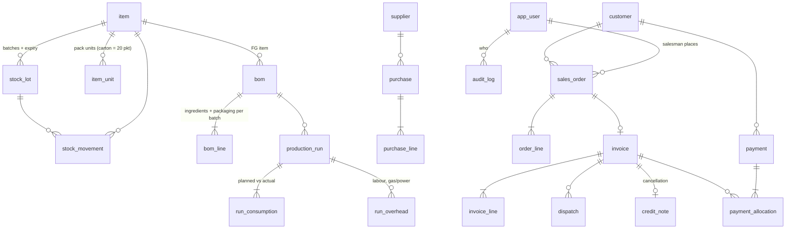

# Architecture: FactoryFlow

*How* the system works. *What* it must do: [project_spec.md](project_spec.md). Build order: [roadmap.md](roadmap.md).

## 1. Shape: modular monolith, one deployable

```
Browser (React PWA, plain JS) ──/api/v1 JSON──> FastAPI ──SQLAlchemy 2──> PostgreSQL 16
            ▲                                       │
            └──── built static files served by ─────┘   (prod: one container, one URL, no CORS)
```

Backend modules (`backend/app/<module>/{models,schemas,service,router}.py`):

| Module | Owns |
|---|---|
| `core` | config, db session, security, **pure maths**: `money`, `units`, `gst`, `wac`, `variance` |
| `auth` | users, roles, JWT, `require_roles()` |
| `masters` | items, units, BOM, customers, suppliers, price list, company settings |
| `inventory` | **`stock_movement` ledger**, lots, `post_movements()`, `allocate()`, balances, reconcile |
| `production` | runs, consumption, overheads, variance, cost per packet |
| `purchasing` | purchases (receipts) |
| `sales` | orders (idempotent), approval, stock check, dispatch |
| `billing` | invoices, FY numbering, credit notes, PDF |
| `payments` | receipts, allocation, outstanding, ageing |
| `reports` | registers, GST summary, stock and production reports, CSV/XLSX |
| `audit` | `audit_log`, `record()` |

Rules: routers stay thin (parse, authorise, call the service). Services own transactions. Only `inventory.service`
writes `stock_movement`. Modules call each other's **services**, never each other's tables.
**Why not microservices:** one factory and about 20 users, and stock must change in the same DB transaction as the
invoice or run that causes it.

## 2. Tech stack

| Layer | Choice | Rejected (why) |
|---|---|---|
| DB | PostgreSQL 16 | SQLite: weak NUMERIC, no `SELECT … FOR UPDATE` |
| API | FastAPI, SQLAlchemy 2 (sync, psycopg 3), Alembic, Pydantic v2 + pydantic-settings | Django: more framework magic to explain live; async SQLAlchemy: harder to debug for ~20 users |
| Auth | PyJWT + `bcrypt` | passlib: unmaintained |
| PDF | fpdf2 + bundled DejaVu TTF (₹ glyph) | WeasyPrint: needs Pango/Cairo system libs |
| Export | openpyxl + stdlib `csv` | pandas: heavy for simple exports |
| Web | React + Vite + Tailwind (JS), React Router, `fetch`, `vite-plugin-pwa` | Next.js: SSR we don't need |
| Offline | localStorage queue + `Idempotency-Key` | Workbox Background Sync: opaque, uneven browser support |
| Tests | pytest on real Postgres (separate test DB) | SQLite or mocks: hide trigger and NUMERIC behaviour |
| Lint | ruff; ESLint + Prettier | black + flake8 + isort |
| Ops | Docker Compose; GitHub Actions | none |

**Hosting** (free, no card, verified 2026-11-23):
- **Render Free web service** (Docker, auto-deploy from `main`). Spins down after 15 min idle, about 1 min cold start, 750 h/month, no persistent disk, so PDFs are generated on request.
- **Neon Free Postgres**: permanent, no card, 1 GB/project, 100 CU-h/month, scale-to-zero after 5 min. **No keep-alive pings**, because they would burn the compute hours.
- Rejected: Render Free Postgres, which is deleted 30 days after creation.

## 3. Data model

Conventions:
- `*_paise BIGINT`; `*_qty NUMERIC(18,3)` in the item **base unit**; `*_bp INT` basis points (500 = 5%).
- Every document has `status` and `created_by/at`.



**`stock_movement`** (the ledger):
- Columns: `item_id`, `lot_id` NOT NULL, signed `qty`, signed `value_paise`, `movement_type` (OPENING, PURCHASE, ISSUE, OUTPUT, SCRAP, DISPATCH, ADJUST, COST_ADJUST, REVERSAL), `movement_date` (the source document's business date, used by period reports; `posted_at` is only the wall clock), `source_type` + `source_id` + `source_line_id` NOT NULL, `reverses_id` (UNIQUE: reversed at most once), `posted_at`, `posted_by`.
- `(lot_id, item_id)` is a composite FK to `stock_lot(id, item_id)`, so a movement can't point at another item's lot. A CHECK ties the qty sign to the type (issues negative, COST_ADJUST zero, ...).
- Balance and value = `SUM(qty)` and `SUM(value_paise)` by item or lot. **There is no balance column.**
- Opening stock and stock-take corrections have their own source document, `stock_adjustment` (+ lines, kind OPENING|ADJUST), so even day-one stock is traceable.

Other key fields:
- **`item`**: `kind` RAW|PACKAGING|FG, `base_uom`, `hsn`, `gst_rate_bp`, `sale_price_paise`, `variance_tol_bp` (default 300), `shelf_life_days`.
- **`stock_lot`**: `lot_no`, `mfg_date`, `expiry_date`, `received_at`, source. Created by an opening, a purchase line or a run output.
- **`invoice`**: `fy`, `seq`, `invoice_no` `FF/2026-27/0001`, `place_of_supply_state`, `supply_type` INTRA|INTER, totals.
  `invoice_sequence(fy, last_seq)` is row-locked, so numbering is gapless.
- **`idempotency_key`**: key, user, route, request hash, stored response. **`audit_log`**: entity, id, action, before/after `jsonb`, user, time; append-only like the ledger.

## 4. Invariants: how each is enforced

| Invariant | Mechanism | Proven by |
|---|---|---|
| Stock derived from ledger | balances are `SUM()` queries; no writable balance | `test_ledger_reconciles_after_every_step` |
| Append-only ledger | DB trigger raises on UPDATE/DELETE/TRUNCATE of `stock_movement` and `audit_log` | `test_ledger_and_audit_log_are_append_only` |
| Traceability | `source_*` NOT NULL; composite lot/item FK; sign CHECK | `test_database_rejects_bad_movements`; ledger invariants after every benchmark step and every integration test (`tests/invariants.py`) |
| No negative stock | item rows locked `FOR UPDATE`; an outflow's balance checked in the same txn, both as of the movement date and currently per lot (a backdated out-of-order outflow can't overdraw) | concurrency + P5 audit test |
| Exact money and quantities | `int` paise, `Decimal` qty, half-up rounding at named points only | unit tests |
| Posted docs immutable | state machine; cancel = credit note + REVERSAL movements | billing tests |
| Audit | `audit.record()` in the same txn as the change | audit tests |
| Role access | `require_roles()` on every route, deny by default; role read from the DB, not the token | `test_every_route_declares_its_roles` + role matrix |

## 5. The hard parts

- **Units:**
  - Global units: `g`, `kg = 1000 g`, `ml`, `l = 1000 ml`, `pcs`, `pkt`.
  - Item-specific packs live in `item_unit` (Murukku: `carton = 20 pkt`).
  - `to_base()` multiplies with Decimal, which is exact. Converting across dimensions is an error.
- **WAC (moving weighted average):**
  - Receipt value = qty × rate.
  - Issue value = `round_half_up(qty × Σvalue / Σqty)`.
  - **Anti-drift:** an issue that empties an item takes all of the remaining value.
  - Lots exist for traceability only; cost is WAC per item.
- **Purchase (one txn):** one lot per line (`PUR-nnnn-k`, received at the purchase date, IST midnight, so FIFO follows business dates). PURCHASE is valued at `receipt_value(entered qty, rate per entered unit)`; input GST is stored on the line but never added to stock value (A15).
- **Production run** (two calls, each one txn with its audit row; the run row is locked `FOR UPDATE`):
  1. **Start** (`POST /production-runs`): planned lines = BOM × batches; ISSUE the raw materials issued now.
  2. **Complete** (`POST /production-runs/{id}/complete`): ISSUE the rest (packaging: pouches 194 = 188 good + 6 damaged), record `damaged_qty` for information only, create the FG lot `RUN-0001` (expiry = run date + shelf life), post OUTPUT +188 valued at the sum of the run's ISSUE values (material cost). A second complete gets 409.
  - **Actual consumption is never stored on the run.** It is `-SUM(qty)` of the run's ISSUE movements per line, so the run and the ledger can't disagree. `source_line_id` for a run: ISSUE → `run_consumption.id`, OUTPUT → `production_run.id`, COST_ADJUST → `run_overhead.id`.
- **Overheads added later** post a `COST_ADJUST` movement (qty 0, value > 0) per overhead line on the run's FG lot, dated on the run date (A18). Append-only, and FG value stays right. Refused when the item has no stock left, because the value would sit on zero quantity.
- **Cost per packet** = (materials issued + run overheads) / good output, half-up to the paisa.
- **Variance:**
  - Planned = BOM qty × batches. `var_bp = (actual − planned) × 10000 / planned`, half-up, for display.
  - Flag when `|actual − planned| × 10000 > tol_bp × planned`: the exact value, not the rounded bp, so 3.004%
    is still flagged. Yield variance is computed the same way on output.
- **Rounding points (the only places we round, all half-up to the paisa):** receipt line value
  (`wac.receipt_value`), issue value (`wac.issue_value`, except an emptying issue), each tax component per line
  (`gst.line_tax`), cost per unit (`wac.cost_per_unit_paise`). Variance bp is rounded for display only.
- **GST:**
  - Company state 33 (TN). Place of supply = customer state.
  - Intra-state: CGST = SGST = `half_up(taxable × bp/2 / 10000)` per line.
  - Inter-state: IGST = `half_up(taxable × bp / 10000)`.
  - FY runs April–March.
- **Stock check:**
  - available = FG on hand − approved-but-undispatched qty.
  - Over-approval returns `INSUFFICIENT_STOCK` with requested, available, shortage and batches needed.
  - Admin can approve a partial quantity or hold the order.
- **Lot allocation:** an outflow that names no lot is split across lots by `post_movements()` itself, using `inventory.allocate()` (FIFO by `received_at`, under the item lock). FEFO = change the sort key to `expiry_date` (stretch toggle).
  - An outflow checks each allocated lot against both its as-of-date balance and its **current** balance. A lot has exactly one inflow (its creation), so only outflows follow and the current balance is its lowest point from the movement date on; checking it stops a backdated, out-of-order outflow from taking stock a later-dated outflow already took.
- **Dispatch and cancellation (P5):** dispatch posts one `DISPATCH` movement per invoice line (outflow, valued at WAC). An invoice is never deleted; `cancel` writes a `credit_note` and `inventory.post_reversals()` posts a `REVERSAL` per dispatch movement — same lot, opposite qty and value, `reverses_id` pointing at the original (UNIQUE, so reversed at most once). Mirroring (not recomputing) makes the undo exact: stock and the item's WAC return to where they were.
- **Payments and outstanding (P6):** a `payment` allocates to invoices (`payment_allocation`) in one transaction; over-allocation is checked under a `FOR UPDATE` lock on each invoice, so concurrent payments can't jointly exceed the total. Outstanding is **derived** — `invoice.total − SUM(allocations)` over non-cancelled invoices — never stored, so it can't drift from the allocations. Payments move money, not stock: nothing posts to the ledger.
- **Reports and the invoice PDF (P7):** reports are read-only. Each is one envelope — `{columns, rows, totals}` — rendered as JSON, or as CSV/XLSX from the same table, so every format carries identical numbers. The stock summary is computed from the same ledger the balances use (opening = `SUM(movement_date < from)`, period = `[from, to]`, closing = `SUM(≤ to)`), so `opening + receipts − issues ± adjustments == closing == SUM(ledger)` holds by construction. The invoice PDF (fpdf2 + a bundled DejaVu TTF for the ₹ glyph) is generated on request and prints the invoice row's own per-line taxes, so its lines always sum to its total.
- **Offline orders:**
  - The PWA queues each order in localStorage with `client_uuid = crypto.randomUUID()` and sends it as the `Idempotency-Key`.
  - Server: same key + same body hash → replay the stored response. Same key + different body → 409. `sales_order.client_uuid` is UNIQUE.
  - The server re-prices from the price list.
