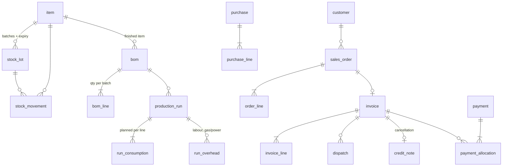

# FactoryFlow: design note

## 1. The idea in one picture

Two loops meet at finished-goods stock, and both are recorded as movements in **one append-only stock ledger**:

```
Purchase ──(+raw)──┐                                   ┌──(−FG)── Dispatch ← Invoice ← Approve ← Order
                   ▼                                   │
              stock_movement  (every row: item, lot, ±qty, ±value in paise, source document, date)
                   ▲                                   │
Production run ──(−raw, −packaging)──(+FG lot RUN-0001)┘        Payments → outstanding (money only)
```

Stock is **never stored as a number someone can overwrite**. An item's balance is `SUM(qty)` and its
value is `SUM(value_paise)` over its ledger rows. A database trigger rejects any UPDATE, DELETE or
TRUNCATE on the ledger. Every row names its source (purchase line, run line, dispatch line, opening
adjustment or credit note), so any balance can be traced back to the documents that made it.

## 2. Data model



Conventions:
- Money is `BIGINT` paise.
- Quantities are `NUMERIC(18,3)` in each item's base unit (g, ml, pcs, pkt).
- Rates are basis points (500 = 5%).
- Posted documents (purchases, completed runs, invoices, payments) can't be deleted. An invoice is cancelled with a credit note, and its dispatch is reversed by mirror-image ledger rows.
- Edits are written to an append-only `audit_log` (who, when, before and after).

## 3. Stock and BOM consumption

- **Units.** Each item has one base unit. kg/L convert by 1,000, and item-specific packs convert by their own factor (1 carton = 20 packets). Conversion uses exact decimals. Mixing dimensions (kg → L) is an error.
- **A run is two steps.**
  1. *Start*: plan = BOM × batches; issue the raw materials actually taken (benchmark: 40 kg flour, **10.5 L oil**, 1.2 kg spice).
  2. *Complete*: issue the packaging actually used (**194 pouches** incl. 6 damaged, **9 cartons**), then post the good output (+188 packets) to a new finished-goods lot `RUN-0001` with an expiry date.
- **Actual consumption is read from the ledger**, never stored twice. It is the run's ISSUE movements, so the variance report and the stock balance can't disagree.
- **Variance.**
  - Variance = (actual − planned) / planned, for each material and for yield (good output vs expected).
  - It is flagged when it is strictly beyond the item's tolerance (3%).
  - The comparison uses exact values, not the rounded percentage.
  - Result: oil +5% flagged, yield −6% flagged, pouches −3.00% not flagged, cartons −10% flagged.
- **No negative stock.** Item rows are locked (`SELECT … FOR UPDATE`) while a document posts. An outflow is checked against the balance on its date and the lot's current balance, so a back-dated entry can't overdraw stock that a later entry already took.

## 4. Costing and valuation

- **Method: moving weighted average cost (WAC) per item.**
  - A receipt adds qty × rate.
  - An issue takes qty × (total value ÷ total qty), rounded half-up to the paisa.
  - An issue that empties an item takes all of the remaining value, so rounding residue never builds up.
  - WAC suits fungible materials like flour and oil, and is simple to explain and audit. FIFO would value the same flour at two prices depending on which sack was opened.
  - Lots track batches and expiry for traceability; they are not cost layers.
- **Overhead rule.**
  - Labour and gas/power are entered against the run and divided by **good** output.
  - If they're entered after the run, they post as value-only movements on the run's finished-goods lot, so the ledger stays append-only and the stock value stays right.
- **Benchmark:** materials ₹4,055 (flour 40 kg at ₹43.125 WAC = ₹1,725; oil ₹1,470; spice ₹240; pouches 194 × 2.50 = ₹485; cartons ₹135) + overheads ₹1,800 = ₹5,855 ÷ 188 = **₹31.14 per packet**, margin ₹18.86 at ₹50.

## 5. Sales, GST and money

- **Orders.** Each order carries a client-generated id that doubles as an `Idempotency-Key`. A salesman on a weak network can resend safely: the server returns the first order, and the same key with a different body is rejected. Prices come from the server's price list, not the phone.
- **Approval.** An order is approved only if available stock (on hand minus approved-but-not-dispatched) covers it. Distributor B's 120 packets are refused with "shortage 32".
- **GST.**
  - Place of supply is the customer's state.
  - Same state as the factory (Tamil Nadu, 33) → CGST + SGST at half the rate each. Any other state → IGST.
  - Tax is computed per line in paise, rounded half-up.
  - Invoice numbers are gapless per financial year (`FF/2026-27/0001`), from a row-locked counter.
- **Outstanding** = invoice total − allocated payments. It is derived, never stored. Concurrent payments are capped at the invoice total under a row lock.
- **Reports** are read-only queries over the same ledger and invoice tables, each rendered as JSON, CSV or XLSX from one table. Opening + receipts − issues ± adjustments = closing holds by construction.

## 6. How correctness is defended

- **Benchmark first.** The section 5 scenario is one pytest that drives the HTTP API as each role. It was written before the code and asserts every expected number.
- **Invariants after every step.** The scenario checks that the ledger reconciles, that there are no orphan movements, and that the API balance equals the ledger sum.
- **Hostile audit.** After each phase, a "ledger auditor" agent wrote tests that try to make stock or money drift: double posts, back-dated outflows, float leaks, rounding residue, concurrent payments, edits to posted rows. Every break it found was fixed and kept as a regression test.
- **Route policy.** A test fails if any API route forgets to declare which roles may call it.

## 7. Trade-offs

- **One deployable (modular monolith).** Stock must change in the same database transaction as the invoice or run that causes it, so microservices would only add distributed-transaction risk.
- **Free hosting.** Render Free (sleeps when idle, ~1 min cold start) + Neon Free Postgres (permanent, no card). PDFs are generated on request because the host has no disk. No keep-alive pings, since they would burn the free compute hours.
- **Thin frontend.** All rules live in Python and SQL, where they're tested. The browser only collects input and shows results.
- **Deferred:** ageing, the GST summary, the owner dashboard, FEFO dispatch, run reversal and master-data screens (see the README's known gaps).
